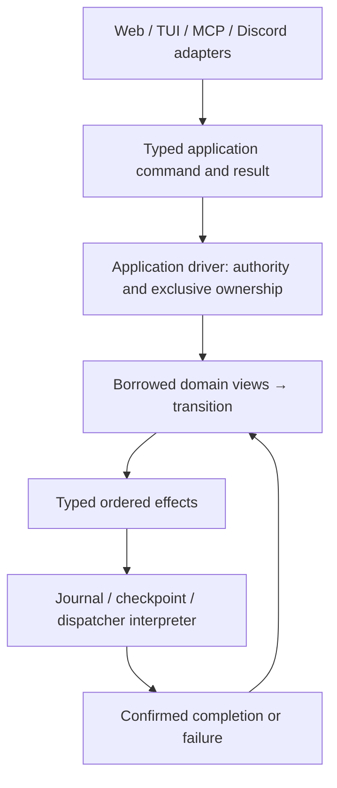

# State and effect boundaries

Application operations borrow the domain state they need, apply a typed input
and return ordered effect descriptions. A driver interprets the effects and
feeds confirmed results back. Rust needs no monad framework for this, and
operations never get ambient access to the whole application `State`.

## Operations on this boundary

**Directed agent messages** (`src/application/messages.rs`). Planning reads
borrowed run, conversation, service, receipt and bot views with an explicit run
ID; it uses no global `State`, JSON, clock, filesystem, lock, channel or
executor. Planning does not mutate state. Applying a plan changes only the
recipient's messages and revision, the run ledger and notice, and the bounded
receipt cache, then returns ordered effects:

1. Archive completed peer evidence (descendant follow-ups skip this).
2. Checkpoint the cross-domain update.
3. Notify the dispatcher, only after the checkpoint is confirmed.

A repeated request returns its stored receipt without effects. The host rechecks
source and recipient authority before applying. Lineage, service generation,
stop scope and capacity rules still apply, and the bot supervisor still decides
whether a message can admit an unattended turn. The driver in
`src/agent_message.rs` holds the application mutex through authorization,
planning, application and persistence. Its transaction guard restores only the
touched fields on failure or unwind before a confirmed checkpoint, and keeps the
committed receipt after confirmation.

**Room wakes** (`src/application/room_wakes.rs`). Planning consumes borrowed
runs, conversations, posts and subscriptions, with an authorization predicate
supplied by the host, and returns wait/advance/disarm/queue decisions. Some
legacy records still carry journal-backed fields, so this is not yet a fully
I/O-free projection. Plans hold positional indices and must be applied under the
same exclusive ownership, with no other writer or suspension in between.

**Room notifications** (`src/application/room_notifications.rs`). Advance,
disarm and queue changes apply through narrow run, chat and wake fields and
return a checkpoint effect plus, for queued notifications, a dispatcher wake.
The blocking interpreter in `src/rooms/notifications/driver.rs` holds the state
borrow through persistence and uses the same guard rules. Cursor-only changes
checkpoint without waking a worker.

**Continuations** (`Submission::into_continuation` in
`src/application/runs.rs`). A continuation borrows the origin's captured
settings and builds a fresh run through `into_run`. Captured models (including
none), lenses and lineage carry over; attempts and stale grants do not. The host
keeps actor authorization, capacity, current grants, clock and IDs, queue order
and dispatcher notification.

**Approval resumption** (`src/application/approval_resume.rs`). A read-only
check over borrowed runs returns `Wait`, `Note` or `Candidate(index)`.
Publication takes an `approval_resume::Edit` holding only runs, the queue notice
and borrowed chat records; `chat::continuation` prepares the admitted run
without changing state. Port and bot drivers acknowledge their request records
in the same checkpoint and wake the dispatcher only after it succeeds. A
rejected save restores the prior edits and sends no wake; reload does not replay
acknowledged requests. Request grouping and rollback still live in those
drivers.

## Alternate driver conformance

The messages and room-notification operations also run under a test-only Tokio
driver (`tokio` is a dev-dependency only) with fake archive and checkpoint
effects. Conformance tests cover ordering, duplicate and restart receipts,
failed archive or checkpoint rollback, unwind, dropping a suspended transaction
before and after a confirmed commit, waiting writers and stale source attempts.
This shows the transitions do not depend on a concurrency runtime. It is not a
production async persistence adapter, a speed comparison or a test of
cancelling in-flight filesystem I/O.

## Checkpoint durability

`storage::checkpoint` distinguishes failures before replacement
(`CheckpointError::NotReplaced`) from failures at rename or directory sync
(`CheckpointError::Unconfirmed`). Success requires both file and directory sync
before state-change subscribers are notified. On an unconfirmed write the
adapter, still holding exclusive ownership, compares the published file with the
intended bytes, then syncs file and directory. Only confirmed equality and
durability count as success; a visible file alone does not.

`storage::save`, used by all production checkpoint callers, returns ordinary
errors only before replacement. If reconciliation cannot settle the outcome, it
requests node shutdown and unwinds, poisoning the state mutex, so no request or
shutdown path can save an in-memory rollback over uncertain disk state. Startup
confirms the checkpoint file and directory before journal recovery and dispatch.
Fault tests inject directory-sync failure and byte mismatches, and check
shutdown, 503 and poison fencing in a child process. They are filesystem fault
injections, not power-loss simulations.

A writer thread per state directory (`control_journal::writer`) owns
`state.json` and `state.log`. A save encodes and diffs under the state mutex,
advances the diff base, queues the record and gets a ticket; the writer writes
everything queued since its last write with one write and one sync (a
compaction contains the lines queued before it). The bytes on disk are those
the synchronous path wrote (`storage::tests::log` pins them). `storage::save`
waits for its ticket under the mutex, so its callers see no change.
`storage::submit` returns before durability for callers that release the
mutex first and then wait; `POST /dna/save` is the only one so far.

The writer's failure policy is one function (`writer::stall_then_halt`): an
unconfirmed write halts the writer at once; a record that is alone in flight
and whose caller still holds the mutex is refused as before (`NotReplaced`, the
caller rolls back, the next save compacts); any other failed record may
already be extended by a later one, so it is retried with backoff for up to 30
seconds, then the writer halts. A halted writer refuses every later save, and
its waiters stop Control as an unconfirmed checkpoint does. If a compaction's
snapshot is durable but its log cannot restart, the writer says so on stderr
and the next save compacts again.

## Limits and next steps

Most saves still wait for durability under the write lock. Before more callers
release the lock before waiting, add durable intent and typed effect identity carrying
source generation and target revisions, revalidate authority and versions on
completion, and reconcile unknown outcomes. A plan from these operations cannot
be kept across another writer or an await: its rollback positions are only safe
under exclusive ownership. An async interpreter must settle an in-flight commit
before giving up that ownership, because dropping a future cannot undo a disk
write.

The application module still shares legacy service, delegation and bot record
types, and other handlers still take broad state. Web rendering remains in the
server. Next candidates are callback admission and bounded queries that let
rendering leave the lock; see [library boundaries](CRATE-BOUNDARIES.md) for the
client/server split.

Benchmark each migrated operation before and after, keeping startup,
allocations, resident memory, history scaling and lock/fsync latency as separate
measurements. Moving code is not a speed improvement. See
[PERFORMANCE.md](PERFORMANCE.md).
