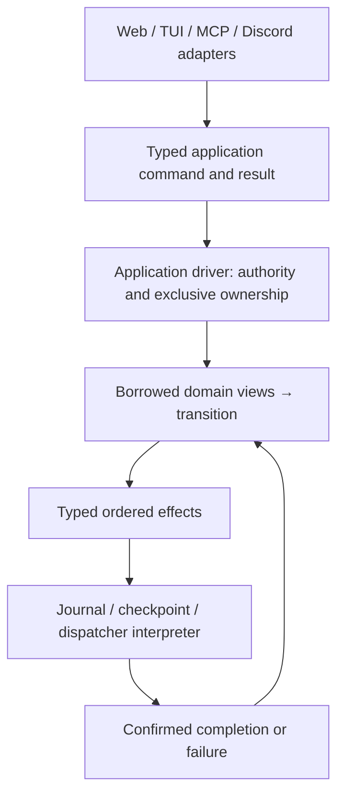

# State and effect boundaries

The direction is a small application layer with explicit transitions and effects.
Rust does not need a general monad framework to provide the useful property:
borrow the required domain state, apply a typed input, return effect descriptions,
and feed interpreted results back into the transition. Lift domain operations
into application operations without granting them ambient access to all state.

## First operation: directed agent messages

`application/messages.rs` plans from borrowed run, conversation, service, receipt
and bot views. It takes an explicit run ID and contains no global `State`, JSON,
clock, filesystem, lock, channel or executor. Command/result/receipt types and
conversation/run records live in `application`; the old module names re-export
records for incremental migration. Saved JSON fields and tool responses retain
their existing format. This operation remains application policy, not a new bot
supervisor concept.

Planning does not mutate state. Applying a plan changes only the recipient's
messages/revision, the run ledger/notice and bounded receipt cache. It returns a
pending transition with explicit effects:

1. Archive completed peer evidence (descendant follow-ups skip this effect).
2. Checkpoint the cross-domain update.
3. Notify the dispatcher, exposed only after checkpoint success is acknowledged.

An existing request receipt returns its typed result without further effects.
The host rechecks source authority and recipient action authority before apply;
lineage, service generation, stop/action scope and capacity rules remain intact.
The existing bot supervisor still decides whether retained peer evidence can
admit an unattended turn. Message delivery does not bypass approvals or create a
second scheduling system.

The current driver in `agent_message.rs` owns the application mutex throughout
authorization, planning, application and journal/checkpoint I/O. Its transaction
guard restores only touched fields on failure or unwind before a confirmed
checkpoint; after confirmation it preserves the committed receipt. No complete
history clone is required. Removed from the operation: the global state handle,
JSON result construction, implicit clock allocation, direct enqueue wakeup and
storage callbacks. The full-state checkpoint and its driver lock remain.

The experimental Tokio driver is **test-only**, using fake archive/checkpoint
effects and real suspension under a Tokio mutex. It runs the same operation and
guard. Conformance checks cover ordering, duplicates/restart receipts, failed
archive/checkpoint rollback, cancellation before and after confirmed commit,
waiting writers and stale source attempts. This proves the transition need not
choose a concurrency runtime; it is not a production async persistence adapter,
an async speed comparison or a test of cancelling in-flight filesystem I/O.

## Remaining boundaries

This is not the complete A1/A2/A4 extraction or a finished server/web/TUI split.
The application module still shares legacy service/delegation/bot record types,
and other handlers still take broad state. The shared loopback MCP client is now
a library module independent of terminal presentation. `control tui` and
`control-harness` call the same library entry point, so they no longer compile
the terminal source separately. An explicit server-only build excludes terminal
code and dependencies; the default build retains the existing CLI. Web rendering
remains in the server. These are module/build boundaries, not the finished
independent crate split. Extract client/protocol code and web presentation
behind actual application commands/queries rather than duplicating the rules or
renaming their existing modules as independent layers.

Before releasing the write lock during persistence, introduce durable intent and
typed effect identity carrying source generation and relevant target/resource
revisions. Revalidate authority and versions when completion returns; reconcile
unknown outcomes. A private plan from this first slice **cannot** be retained
across another writer or an await between planning and apply. Its rollback
positions are safe only under exclusive ownership. An async interpreter must
settle an in-flight commit's outcome before surrendering that ownership; dropping
a future cannot undo a disk write whose outcome is unknown.

Next, migrate callback admission and continuation/approval operations behind the
same style of interface, then bounded queries that let web rendering leave the
lock. Finish the client/TUI crate boundary over the shared library interface;
extract web routing/rendering separately. Keep model and
engine execution in adapters. Core crates retain generic state/event/effect rules
and no HTTP, terminal, provider or runtime dependency.

Benchmark the affected operation and sample real stacks before and after each
slice. Keep startup, allocations/resident memory, history scaling and lock/fsync
latency as separate measurements; a file move is not a speed improvement. See
[PERFORMANCE.md](PERFORMANCE.md) for fixtures and measurement limits.
