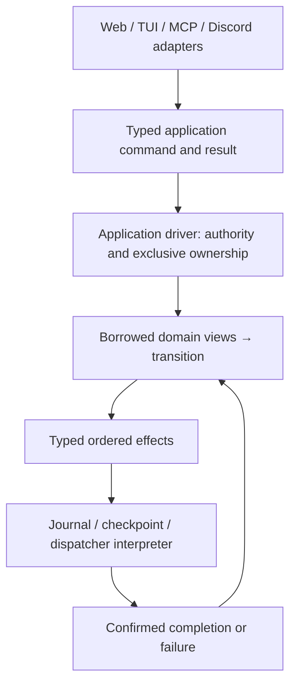

# State and effect boundaries

The direction is a small application layer with explicit transitions and effects.
Rust does not need a general monad framework to provide the useful property:
borrow the required domain state, apply a typed input, return effect descriptions,
and feed interpreted results back into the transition. Lift domain operations
into application operations without granting them ambient access to all state.

## First operation: directed agent messages

`application/messages.rs` plans from borrowed run, conversation, service, receipt
and bot views. It takes an explicit run ID and contains no global `State`, JSON,
clock, filesystem, lock, channel or executor. Command/result/receipt types and
conversation/run records live in `application`; the old module names re-export
records for incremental migration. Saved JSON fields and tool responses retain
their existing format. This operation remains application policy, not a new bot
supervisor concept.

Planning does not mutate state. Applying a plan changes only the recipient's
messages/revision, the run ledger/notice and bounded receipt cache. It returns a
pending transition with explicit effects:

1. Archive completed peer evidence (descendant follow-ups skip this effect).
2. Checkpoint the cross-domain update.
3. Notify the dispatcher, exposed only after checkpoint success is acknowledged.

An existing request receipt returns its typed result without further effects.
The host rechecks source authority and recipient action authority before apply;
lineage, service generation, stop/action scope and capacity rules remain intact.
The existing bot supervisor still decides whether retained peer evidence can
admit an unattended turn. Message delivery does not bypass approvals or create a
second scheduling system.

The current driver in `agent_message.rs` owns the application mutex throughout
authorization, planning, application and journal/checkpoint I/O. Its transaction
guard restores only touched fields on failure or unwind before a confirmed
checkpoint; after confirmation it preserves the committed receipt. No complete
history clone is required. Removed from the operation: the global state handle,
JSON result construction, implicit clock allocation, direct enqueue wakeup and
storage callbacks. The full-state checkpoint and its driver lock remain.

The experimental Tokio driver is **test-only**, using fake archive/checkpoint
effects and real suspension under a Tokio mutex. It runs the same operation and
guard. Conformance checks cover ordering, duplicates/restart receipts, failed
archive/checkpoint rollback, cancellation before and after confirmed commit,
waiting writers and stale source attempts. This proves the transition need not
choose a concurrency runtime; it is not a production async persistence adapter,
an async speed comparison or a test of cancelling in-flight filesystem I/O.

## Remaining boundaries

One-shot room wake planning (#151) lives in `application/room_wakes.rs`.
It consumes borrowed runs, conversations, posts and
subscription references, with an authorization predicate supplied by the host.
It returns typed wait/advance/disarm/queue decisions. Continuation validation is
shared with the existing listener driver through a compatibility wrapper.
No global `State`, JSON encoding, clock or executor is passed to the planner.
Legacy records still include journal-backed fields; this is not yet a fully
materialized, I/O-free domain projection. Queue capacity, grants and effect
interpretation remain host responsibilities.
Its plans contain positional indices and must be consumed under exclusive
ownership, without another writer or suspension between planning and application.
The publication follow-up adds `application/room_notifications.rs`: typed
advance/disarm/queue changes apply through narrow mutable run, chat and wake
fields. The persisted wake receipt moves with its existing fields and defaults;
saved JSON, notification text, captured settings and grant inheritance stay the
same. Run identity is supplied by the driver. A queued run is constructed from
captured settings directly rather than resolving provider defaults and then
overwriting them.

Applying a change returns a pending transition with ordered checkpoint and, for
queued notifications, dispatcher-wake effects. The blocking interpreter in
`rooms/notifications/driver.rs` owns the state borrow through persistence. Its
guard restores only touched fields on failure or unwind before a confirmed
checkpoint. A failure after confirmation retains the durable queued run. This
aligns notification delivery with directed messages: dispatcher notification is
exposed only after the save succeeds, rather than as a side effect of enqueue.
Cursor-only changes checkpoint without waking a worker.

Conformance fixtures exercise the same transition and guard with blocking and
test-only Tokio interpreters, failed checkpoints, unwind, dropping a suspended
transaction before/after confirmed commit, and restart without duplicate
publication. These use fake persistence and do not establish safety of cancelling
an in-flight filesystem commit. Production persistence remains synchronous and
under the existing lock; neither the scheduler nor core gains a runtime or a
notification-specific lifecycle.

`storage::checkpoint` now distinguishes failures before attempting replacement
(`NotReplaced`) from failures at rename or directory sync (`Unconfirmed`). Success
requires both file and directory sync before notifying state-change subscribers.
Real-file tests inject a directory-sync failure after replacement and verify that
the new bytes are visible despite the error. This is an adapter boundary, with
no new supervisor state, runtime or persistence dependency.

The storage adapter now reconciles an unconfirmed write once, while retaining
exclusive writer ownership. It compares the published regular file with the
exact intended bytes using a bounded buffer, then syncs that file and directory.
Only confirmed equality/durability returns success and notifies subscribers.
Different, missing or unreadable bytes remain unconfirmed; a visible file alone
is not a durable acknowledgement. Successful writes gain no extra reads/syncs.

The legacy `storage::save` adapter returns ordinary errors only before replacement.
If reconciliation cannot establish the outcome, it requests existing node
shutdown and unwinds, poisoning the shared state mutex. Requests/dispatch cannot
reacquire it, and shutdown cannot save an in-memory rollback over uncertain disk
state. Project-approval staging files survive unwind, since that checkpoint may
reference them. This deliberately changes the unreconciled-error path from an
unsafe retry into a stopped node; no timeout, new supervisor mode or durable
status object is introduced. All current production checkpoint callers use this
adapter. Future consumers of the typed API must handle `Unconfirmed` explicitly.

Startup confirms the checkpoint file and directory before journal recovery and
dispatch. Fault tests cover transient directory-sync failure, exact-byte mismatch,
an approval resume surviving reload without duplicate admission, and persistent
uncertainty in a child process that verifies shutdown/503/poison fencing and
retained candidate bytes. These are filesystem fault injections, not a hardware
power-loss simulation. Persistence remains synchronous under the write lock;
durable intent, generation/revision validation and cancellation settlement remain
necessary before moving it outside that lock or introducing an async interpreter.

This is not the complete A1/A2/A4 extraction or a finished server/web/TUI split.
The application module still shares legacy service/delegation/bot record types,
and other handlers still take broad state. The shared loopback MCP client is now
a library module independent of terminal presentation. `control tui` and
`control-harness` call the same library entry point, so they no longer compile
the terminal source separately. An explicit server-only build excludes terminal
code and dependencies; the default build retains the existing CLI. Web rendering
remains in the server. These are module/build boundaries, not the finished
independent crate split. Extract client/protocol code and web presentation
behind actual application commands/queries rather than duplicating the rules or
renaming their existing modules as independent layers.

Before releasing the write lock during persistence, introduce durable intent and
typed effect identity carrying source generation and relevant target/resource
revisions. Revalidate authority and versions when completion returns; reconcile
unknown outcomes. A private plan from this first slice **cannot** be retained
across another writer or an await between planning and apply. Its rollback
positions are safe only under exclusive ownership. An async interpreter must
settle an in-flight commit's outcome before surrendering that ownership; dropping
a future cannot undo a disk write whose outcome is unknown.

Continuation construction now uses `Submission::into_continuation` in the
application layer. It borrows the origin's captured settings and constructs a
fresh run through the shared `into_run` constructor. The host still owns actor
authorization, capacity, current service grants, clock/ID, queue ordering and
dispatcher notification. Captured models (including `None`), lenses and lineage
remain unchanged; attempts and stale grants are not copied. No record/schema or
provider-session change is involved.

Approval eligibility now lives in `application::approval_resume`: a read-only
operation over borrowed runs derives `Wait`, `Note` or `Candidate(index)`.
The host keeps authorization, capacity, request acknowledgement and durable
publication, using the same continuation constructor. Existing busy-chat,
human-steering, design-answer and failure rules are unchanged. Candidate indices
are ephemeral under exclusive state ownership, not plans to carry across an
await or another writer.

Approval publication now takes an `approval_resume::Edit` containing only runs,
the queue notice and borrowed chat records. `chat::continuation` prepares an
admitted run without changing state or notifying a dispatcher. The host adds
current grants, then the application operation records that run and its note.
Port and bot drivers acknowledge their existing request records in the same
checkpoint and notify the dispatcher only after successful persistence. Ordinary
save rejection restores the prior edits and sends no wake; reload does not replay
acknowledged requests. The existing checkpoint adapter reconciles or fences an
uncertain publication instead of returning an ordinary rollback error.

This completes the ordering of this blocking path, not its full extraction:
request grouping, acknowledgement and rollback still live in the existing port
and bot drivers, and bot reconciliation retains its wider snapshot. The root
lock remains held throughout. No async or out-of-lock persistence is enabled.

Bot presentation reads pause intent independently from the supervisor's retained
turn handle. An outstanding request is not evidence of execution: queued work
is labelled queued, a paused queued bot is paused, and an already-executing turn
remains visible as running while paused. This projection changes no admission,
pause, rearm or cancellation semantics and adds no persisted status source.

Next, migrate callback admission and continuation/approval operations behind the
same style of interface, then bounded queries that let web rendering leave the
lock. Finish the client/TUI crate boundary over the shared library interface;
extract web routing/rendering separately. Keep model and
engine execution in adapters. Core crates retain generic state/event/effect rules
and no HTTP, terminal, provider or runtime dependency.

Benchmark the affected operation and sample real stacks before and after each
slice. Keep startup, allocations/resident memory, history scaling and lock/fsync
latency as separate measurements; a file move is not a speed improvement. See
[PERFORMANCE.md](PERFORMANCE.md) for fixtures and measurement limits.
